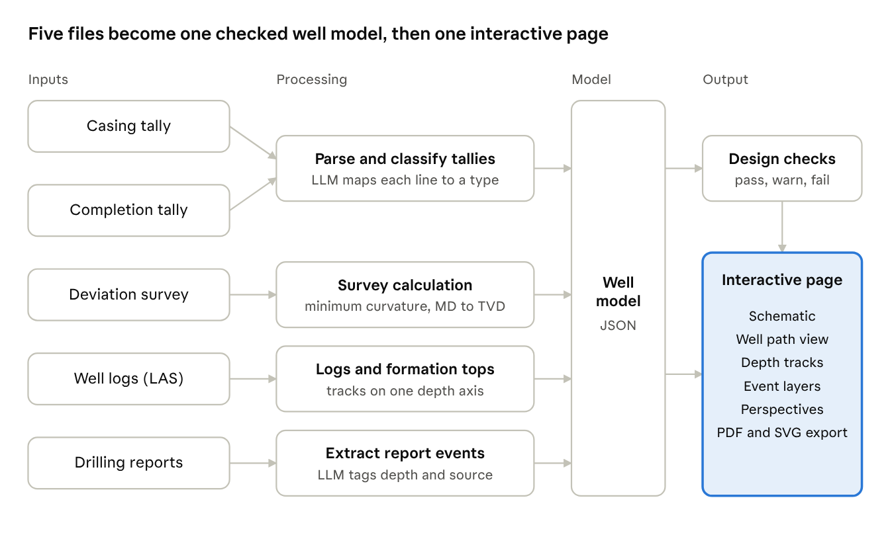

# Auto Wellbore Schematic

A hackathon concept: draw a complete, checked wellbore schematic automatically from a casing tally, a completion tally, a deviation survey, well logs and daily drilling reports, with no manual drawing.

## What's here

| Path | What it is |
| --- | --- |
| [`docs/concept.md`](docs/concept.md) | The concept: inputs, outputs, pipeline, perspectives, design checks, data source, 2-day plan, demo script, risks |
| [`mockup/index.html`](mockup/index.html) | A single-file interactive mockup of the output page |

## Viewing the mockup

Open `mockup/index.html` in a browser. It needs no build step or server; fonts load from Google Fonts.

The mockup shows:

- A wellbore schematic with formation column, gamma ray, resistivity and survey tracks on one depth axis
- A 1:1 well path view through flat formation layers
- Design checks computed from the data (pass, warn, fail)
- The completion tally as raw rig text, classified into component types with confidence scores
- An MD / TVDSS / both label switch, and hover highlighting between the table and the drawings

The deviation survey is computed in the page with the minimum-curvature method, and every depth, formation top and check is derived from it.

## Data

Every number in the mockup is synthetic, made to resemble a deviated North Sea producer ("Example well A-12"). Formation names follow the public Norwegian North Sea stratigraphy. Symbols are generic.

The concept plans to use Equinor's open [Volve dataset](https://www.equinor.com/energy/volve-data-sharing) for real wells. No Volve data is included in this repository; it is covered by Equinor's own licence.

## Licence

[MIT](LICENSE)
