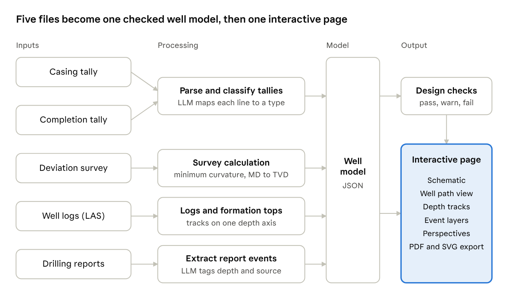

# Automated Wellbore Schematic

Hackathon concept · November 2026

## Summary

We will build a tool that draws a complete, checked wellbore schematic from rig files, with no manual drawing. It also turns daily drilling reports into depth-tagged events that sit on the schematic as switchable layers.

Today engineers redraw schematics by hand in Visio or PowerPoint. They drift out of date after each workover, every engineer draws them differently, and the well history sits in free-text reports nobody reads twice. Our tool produces one consistent, traceable view of the well in seconds, and flags design problems before they reach the rig.

A working mockup with synthetic data is in [`mockup/index.html`](../mockup/index.html).

## Inputs

Five files go in; the user types nothing else. Formation tops come from a field type well or offset tops prepared once per field.

| Input | Typical format | What we take from it |
| --- | --- | --- |
| Casing tally | Excel or CSV | Strings, OD/ID, weight, grade, shoe depths, hangers, crossovers, cement tops |
| Completion tally | Excel or CSV | Every downhole component in running order: description, OD/ID, length, depth |
| Deviation survey | CSV or WITSML | MD, inclination, azimuth at each station |
| Well logs | LAS or DLIS | Gamma ray, resistivity, density/neutron, caliper |
| Daily drilling reports | PDF, text or WITSML | Losses, kicks, stuck pipe, mud type and weight, cement jobs, NPT |

## Outputs

One interactive page per well, every item labelled in MD and TVD, exportable to PDF and SVG.

- **Wellbore schematic.** Nested casing with cement and shoes, liner hanger, tubing, safety valve and control line, gas lift mandrels, gauges, nipples, packers, entry guide and perforations. Not to scale across the hole, with a vertical scale break so the completion stays readable.
- **Depth tracks beside it.** Formation column, gamma ray, resistivity, and a survey track with inclination and dogleg severity, all on the same depth axis as the schematic.
- **Well path view.** A 1:1 vertical section through flat formation layers, with casing shoes, completion items, kick-off point, end of build and TD.
- **Classified tally.** Each raw tally line, the component type it was mapped to, and a confidence score. Hovering a row highlights the item in both drawings.
- **Design checks.** Pass, warn or fail for each rule, with the numbers behind it.
- **Event layers.** Losses, kicks, mud and integrity data from the daily reports, placed at depth.

## How it works

Each file feeds one processing step, and all steps write into a single well model that the checks and the page read from.

The LLM does two jobs: classifying tally lines and pulling events from reports. Everything else is deterministic, so the drawing and checks can be tested and repeated.

## Perspectives and layers

The chosen perspective decides what is shown: one click switches layers, the side panel and the event ranking. The page opens on the Well summary.

| Perspective | Layers on | Side panel |
| --- | --- | --- |
| Well summary (default) | Casing, completion, formations, top 5 events by severity, mud weight band, barrier pass/fail | Design-check summary |
| Drilling | Mud type and weight, pore pressure and fracture gradient, LOT/FIT, losses, kicks, stuck pipe, washouts | NPT by hole section, report events |
| Integrity | Barrier envelopes, cement planned vs actual, annulus pressures | Barrier element status, open issues |
| Completion | Component details, IDs, nipple profiles, tool reach vs inclination | Tally checks, intervention access |
| Production | Perforations by contribution, production log inflow, water entry | Rate and water cut history |

Each perspective also gets a three-line briefing written by an LLM, for example: "2 loss events in the 12¼" section, 340 bbl in total, both at top Utsira, cured with LCM."

**Traceability.** Clicking any event opens the report paragraph it came from, with date and report number.

**Stretch goals.**

- Time slider that plays the well's life from spud through each section, completion and workovers.
- Offset-well hazards: losses and kicks from nearby wells projected into this well by TVDSS, as a forecast for the next well.

## Design checks

The checks turn the tool from a drawing aid into a design review. Thresholds below are starting values to confirm with well engineers.

| Check | Rule | Result if broken |
| --- | --- | --- |
| Depth reconstruction | Cumulative tally lengths match recorded depths within 0.5 m | Fail |
| Duplicate or missing joints | No repeated serial numbers or gaps in joint numbering | Fail |
| Packer setting | Packer inside the correct casing, above its shoe, below top of cement | Fail |
| Entry guide | Tubing tail above the liner top | Fail |
| Perforations | Every perforated interval inside a reservoir formation | Warn |
| Dogleg at equipment | Gauges, packers, valves and pumps not set where dogleg severity exceeds 3°/30 m | Warn |
| Wireline access | Nipples and sleeves below about 65° inclination flagged as needing tractor or coiled tubing | Warn |
| ID drift | Nipple and component IDs step down in the right order | Fail |
| Mud weight window | Mud weight between pore pressure and fracture gradient for each section | Warn |

## Data source

We plan to use Equinor's open Volve dataset (North Sea, released 2018). The contents below are from memory and need checking against the download.

- **Expected in Volve:** well logs (LAS/DLIS), deviation surveys, an EDM export with casing and completion strings, formation picks, WITSML drilling data and daily reports, completion and end-of-well reports as PDFs.
- **Download:** well data folders only. The full set with seismic is several hundred GB.
- **Wells to start with:** producers such as 15/9-F-12 and 15/9-F-14, which are deviated and have full completions.
- **Ground truth:** Equinor's formation picks let us score our automatic picks.
- **Licence:** registration and Equinor's open data licence are required. Confirm it covers hackathon use.
- **Fallback:** if the EDM data is thin, build tallies that match a real Volve well's survey and casing depths, and plant errors for the checks to catch.

## Scope and 2-day plan

The must-haves fit in two days if tallies for 2–3 wells are converted to CSV before the event.

**Must have:** tally parsing with LLM classification, minimum-curvature survey, LAS reading, schematic and path view, design checks, losses and events from daily reports, Well summary plus Drilling and Integrity perspectives.

**Stretch:** automatic formation picks, time slider, offset-well hazards, Completion and Production perspectives, PDF export.

| Block | Work | Done when |
| --- | --- | --- |
| Before the event | Download Volve well data, pick 2–3 wells, convert casing and completion data to CSV | Clean input files for each well |
| Day 1 morning | Tally parser and LLM classifier, survey calculation, LAS reader, shared data model | One JSON well model per well |
| Day 1 afternoon | Report event extraction with source links; mud and pressure data | Events tagged with depth and source |
| Day 2 morning | Schematic, path view, depth tracks, design checks | Full page renders for one well |
| Day 2 afternoon | Perspectives, briefings, second well, demo rehearsal | Demo runs end to end twice |

## Demo script

Five minutes, three clicks across three roles.

1. Drop five files for a Volve well into the tool. The schematic, path view and tracks appear in seconds.
2. Show the classified tally: messy rig descriptions mapped to clean component types.
3. Show the checks catching a planted error: a duplicate joint that would put everything below it 12 m too deep.
4. Click a loss marker to open the report paragraph it came from.
5. Switch to Drilling: the losses line up with mud weight close to the fracture gradient.
6. Switch to Integrity: barrier envelopes and cement tops, planned vs actual.
7. Close on the point: from hours of drawing to seconds, with a design review included.

## Risks and open questions

The biggest risk is messy input data, so most of the mitigation happens before the event.

| Risk | Mitigation |
| --- | --- |
| Tally formats vary and are messy | Convert 2–3 wells to CSV beforehand; LLM classifier with confidence scores and manual override |
| Automatic formation picks are unreliable | Use Volve picks or a field type well; automatic picking is a stretch goal |
| Report extraction misses or invents events | Every event links to its source paragraph; show confidence; test on one well first |
| Volve contents differ from what we expect | Check the download before the event; synthetic fallback tallies |
| Drawing takes longer than planned | Reuse the mockup's layout and symbol code |

**Open questions**

- [ ] Which 2–3 Volve wells have complete casing, completion and report data?
- [ ] Does Equinor's licence cover hackathon use?
- [ ] Who on the team owns parsing, drawing and LLM extraction?
- [ ] What check thresholds do well engineers want?
